# Fightcord

[Site](https://fightcord.pages.dev/pt/) · [English](README.md) · **Português (Brasil)** · [Español](README.es.md)

**O Fightcade com a cara e o jeito do Discord**, mais um monte de ferramentas para quem joga
competitivo. Um instalador, nenhum outro download, tudo rodando dentro do app do Fightcade no seu PC.

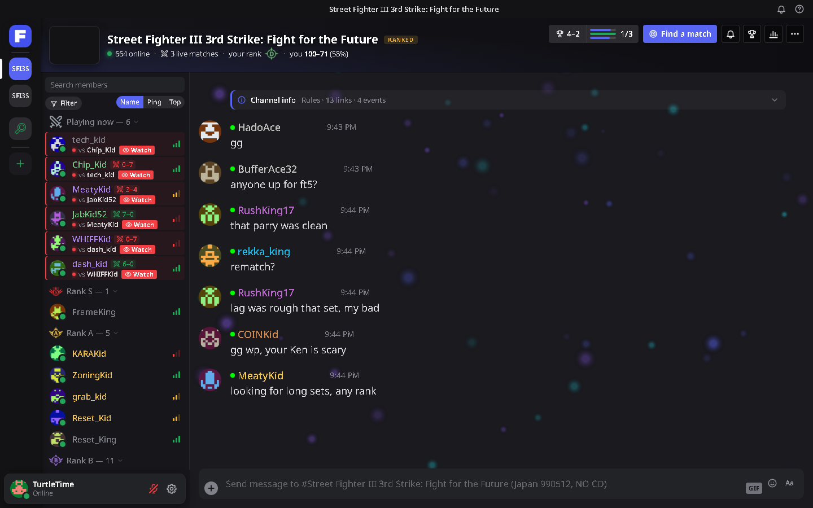

> O Fightcord é um mod feito por fãs, que roda só no seu computador. Ele **não** é feito pelo
> Fightcade nem pelo Discord, nem tem ligação ou aval deles.

> **🤖 Vibe-coded.** Tudo aqui (o mod, o instalador, o site, este README) é feito descrevendo o que
> deve fazer para um assistente de programação com IA (Claude Code), que escreve o código. Tudo é
> conferido com testes automáticos e usado no Fightcade antes de cada versão, e o código é aberto,
> então você pode ler cada linha.

## Download

Baixe o **`FightcordSetup.exe`** na [versão mais recente](https://github.com/JillTheStingray/fightcord/releases/latest),
feche o Fightcade, rode o instalador e clique em **Instalar**. Pronto: abra o Fightcade e uma tela
de boas-vindas curta te guia pelo resto.

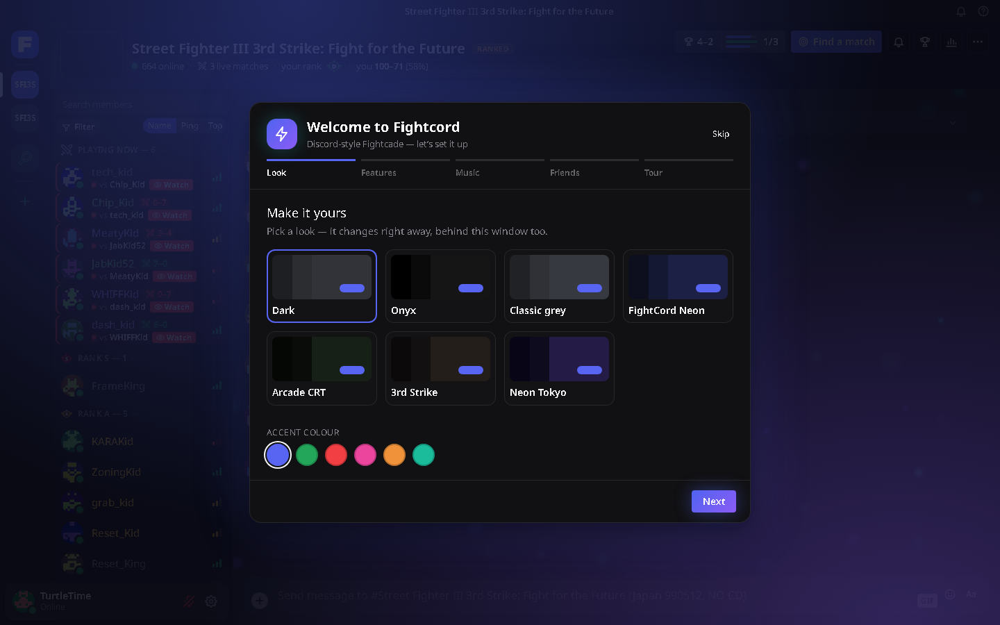

- Windows 10 / 11, o app normal do Fightcade 2. Não precisa de administrador.
- O instalador encontra o Fightcade sozinho (Documentos, OneDrive, `C:\Fightcade`, ou um Fightcade
  aberto); se não, clique em Procurar.
- **"O Windows protegeu o computador"?** O instalador não tem assinatura digital (certificados
  custam caro), então o SmartScreen avisa na primeira vez: **Mais informações → Executar assim mesmo**.
  Alguns antivírus também desconfiam de instaladores novos sem assinatura: o Malwarebytes, por
  exemplo, pode colocá-lo em quarentena como "MachineLearning/Anomalous", que é um palpite de IA e
  não uma ameaça conhecida. Se confiar, restaure-o da quarentena, ou compile você mesmo a partir
  deste repositório (veja abaixo).
- **As atualizações** acontecem dentro do Fightcade: quando você abre, o Fightcord confere as versões
  deste repositório e instala a nova antes de carregar (conferida por checksum). Você nunca precisa
  voltar aqui nem rodar o instalador de novo. Se o Fightcade fica aberto por dias, um botão verde na
  barra da esquerda oferece reiniciar quando a atualização está pronta, e Configurações → Atualizações
  mostra as novidades.
- **Desinstalar:** rode o instalador de novo → Desinstalar. Suas configurações ficam guardadas numa
  pasta de backup.

## O que você ganha

**O visual**
- Um tema estilo Discord: Escuro, AMOLED, Cinza clássico ou FightCord Neon, qualquer cor de destaque,
  seu próprio fundo no chat, ou suas próprias cores no editor de tema.
- Barra de canais, lista de membros (agrupada por rank, com ping, avisos de Wi-Fi/VPN e posição no
  ranking), cartões ao passar o mouse, painel de perfil e menu do botão direito, tudo estilo Discord.
- A aba de busca vira uma página Descobrir feita para você: seus jogos com seu rank e ELO, amigos
  jogando agora, rivais livres para jogar, partidas ao vivo, os eventos da semana, categorias, busca
  instantânea e páginas de jogo.
- Uma nova tela de login: arte dos jogos atrás de um cartão elegante, o mascote do FightCord e um
  bem-vindo de volta com seu rank e sua última sessão.
- Seu estilo no emulador: a barra com os nomes e o placar nas suas partidas na cor do seu tema, e doze
  fontes para escolher (pixel, fliperama, esports, ...), cada uma com prévia.
- Um visualizador de música atrás do chat: barras, uma onda ou um anel pulsante que se movem com a sua
  música de fundo e batem forte a cada bumbo.
- Um lobby mais calmo: a lista de membros à esquerda, uma linha por jogador, um só botão de Filtro, e o
  retrospecto da noite com suas metas numa faixa na barra de cima.
- O ranking do jogo, replays para assistir, eventos e perfis de jogadores dentro do Fightcade, além de uma
  tela de VS com a arte do jogo, personagens no seu status do Discord e notas de confronto por personagem.
- Visuais num clique: CRT de fliperama, 3rd Strike e Neon Tokyo mudam juntos as cores, a fonte, o fundo e
  a fonte do emulador.
- Chat: menções, horários, prévias de links, ir para o presente, atalhos `:emoji:`, estilos de fonte
  e tradução automática das mensagens recebidas.

| | |
|---|---|
| 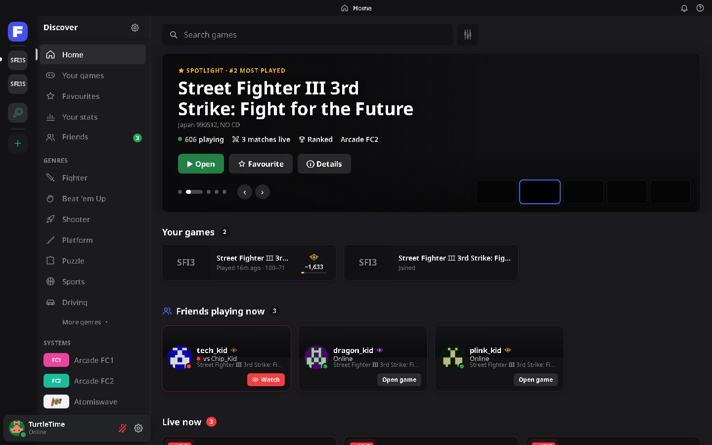 | 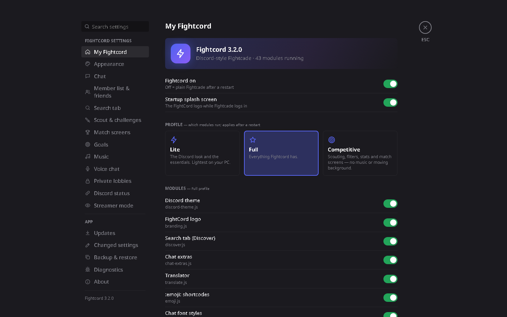 |
| 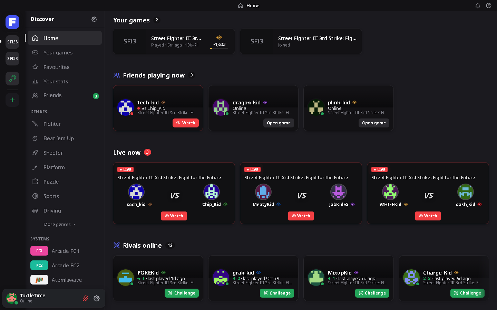 | 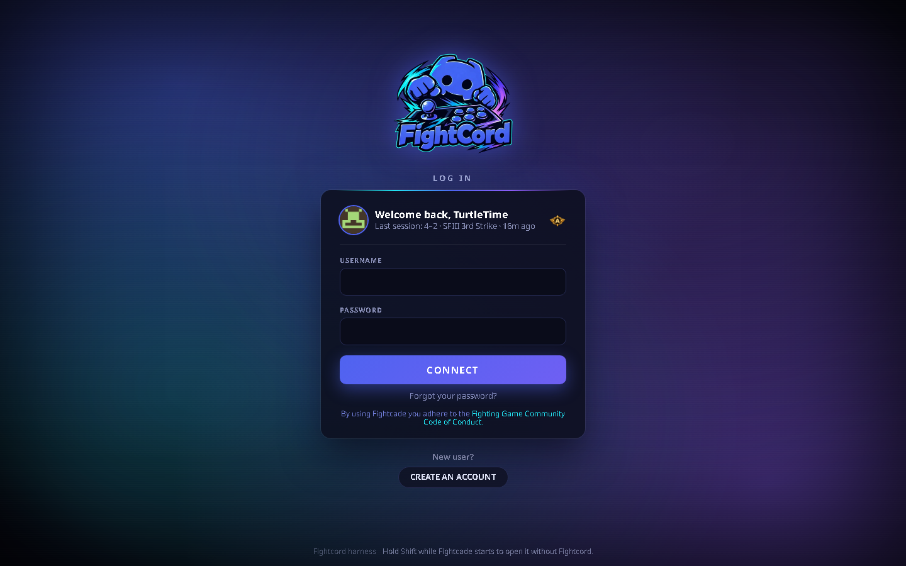 |

**Para quem joga competitivo**
- **Ficha do oponente:** rank, ELO, chances de vitória e o confronto direto de vocês, assim que ele
  te desafia. O ELO é exato para apoiadores do Fightcade no Patreon (o Fightcade só manda para eles)
  e estimado pelo rank e pela posição no ranking para todo o resto. Ela também avisa quando alguém
  costuma abandonar sets ranked.
- **Filtros de desafio:** avisam ou recusam desafios automaticamente por ping, Wi-Fi / VPN, país,
  formato do set, rank, jogadores que você nunca enfrentou, ou uma lista de bloqueio.
- **Achar partida:** um botão mostra quem está livre agora perto do seu rank, com ping bom, novo
  para você ou equilibrado no confronto direto, com suas chances e um botão Desafiar.
- **Telas de partida:** VS / VOCÊ VENCEU! / VOCÊ PERDEU!, e o placar da noite no topo do canal.
- **Estatísticas:** seu histórico, confrontos diretos, sequências e um cartão para compartilhar.
- **Histórico de rank e ELO:** um gráfico do seu rank ao longo do tempo em cada jogo, com
  comemoração quando você sobe.
- **Metas de treino:** "vencer 5 sets", "derrotar 3 rank A", "jogar uma hora"… acompanhadas ao vivo,
  com resumo da sessão.
- **Análise de partidas:** taxa de vitória por rank do oponente, ping, hora do dia e formato do set,
  mais um alerta de tilt.

| | |
|---|---|
| 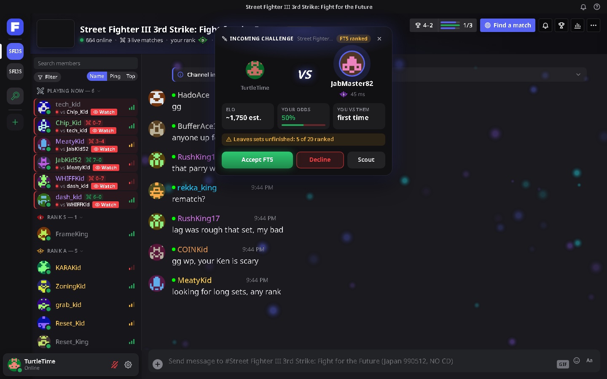 | 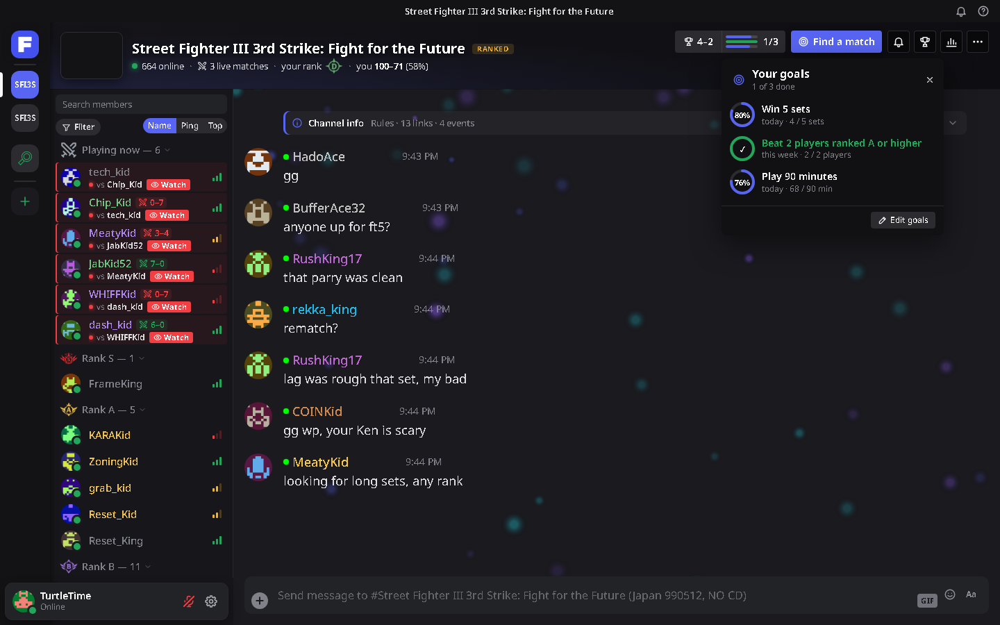 |
| 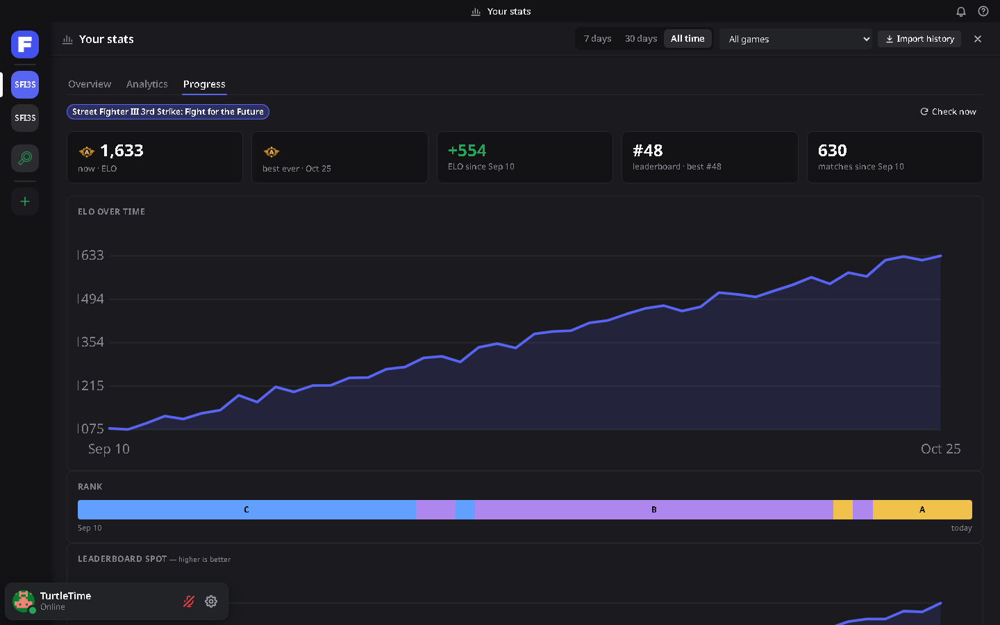 | 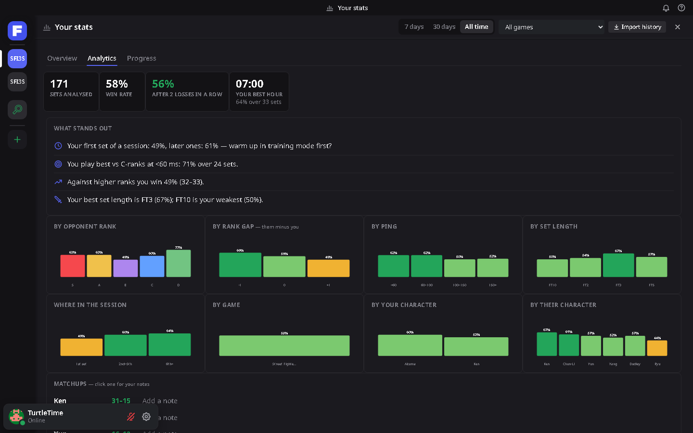 |

**Lobbies privados** (novo na 2.14)
- Seu próprio **lobby só com convite, como um servidor do Discord**: o **+** embaixo dos seus canais
  de jogo cria um ou entra em um com um código de convite. Só entra quem tem o código e o Fightcord.
- Um **chat que guarda o histórico**, uma **lista de membros** (online, ausente, numa partida, na voz)
  com **Desafiar** (o Fightcord leva vocês dois para o canal do jogo do lobby) e uma **sala de voz** para até 8.
- O dono pode renomear o lobby, trocar o jogo, criar um código de convite novo ou remover alguém (todos
  os outros recebem uma chave nova, então essa pessoa não consegue ler nada novo).

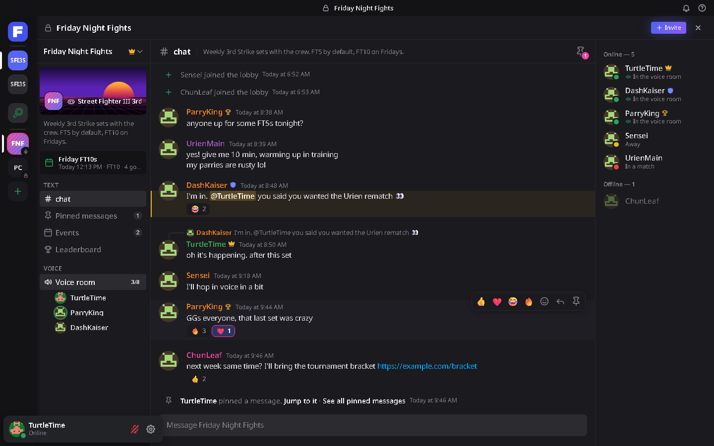

**Social**
- **Lista de amigos** com avisos de online / partida e botão Assistir, mais **notas e etiquetas de
  jogadores**.
- **Feed do lobby:** entradas, partidas para assistir, zebras e sequências de vitórias em cada canal.
- **Lembretes de eventos:** um aviso antes dos torneios do Fightcade dos seus jogos começarem (ou de
  qualquer evento em que você tocar o sininho), com um botão para abrir o canal.
- **Status no Discord:** mostra seu jogo, oponente e o tempo de partida no seu perfil do Discord.
- **Lobbies privados**, como um servidor do Discord: só com convite, com um chat que guarda o histórico, lista de membros com Desafiar e uma sala de voz para até 8.
- **Imagens, GIFs e clipes no chat** para quem usa o Fightcord: cole, solte ou clique no +, favorite GIFs e envie de novo pelo botão GIF.
- **Música** no lobby (traga sua própria faixa; nenhuma vem incluída).

**Para streamers**
- **Modo streamer:** Ctrl+Shift+H borra nomes, avatares e o chat dos outros jogadores na tela,
  coloca os desafios numa fila (um por vez, nenhum durante a partida) e silencia avisos com nomes.
- **Overlay do OBS:** um placar (você vs seu oponente, ranks, o placar e o saldo da noite) para
  adicionar no OBS como fonte de Navegador.

| | |
|---|---|
| 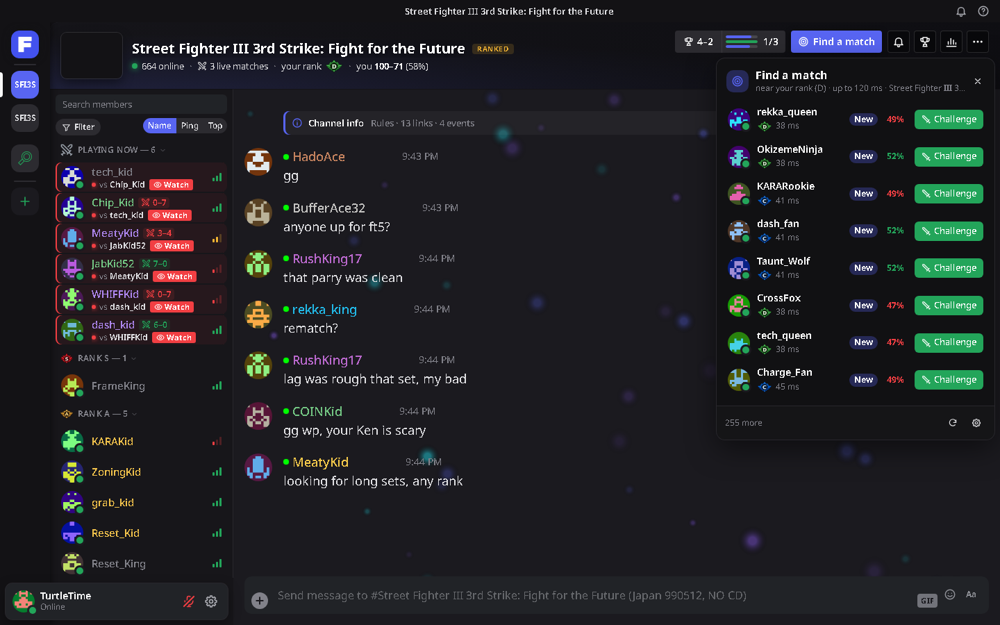 | 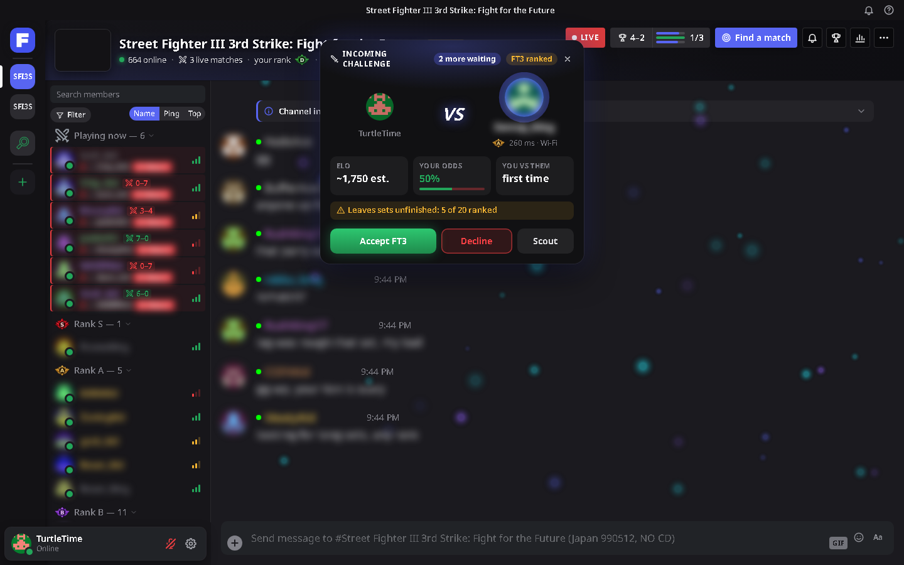 |

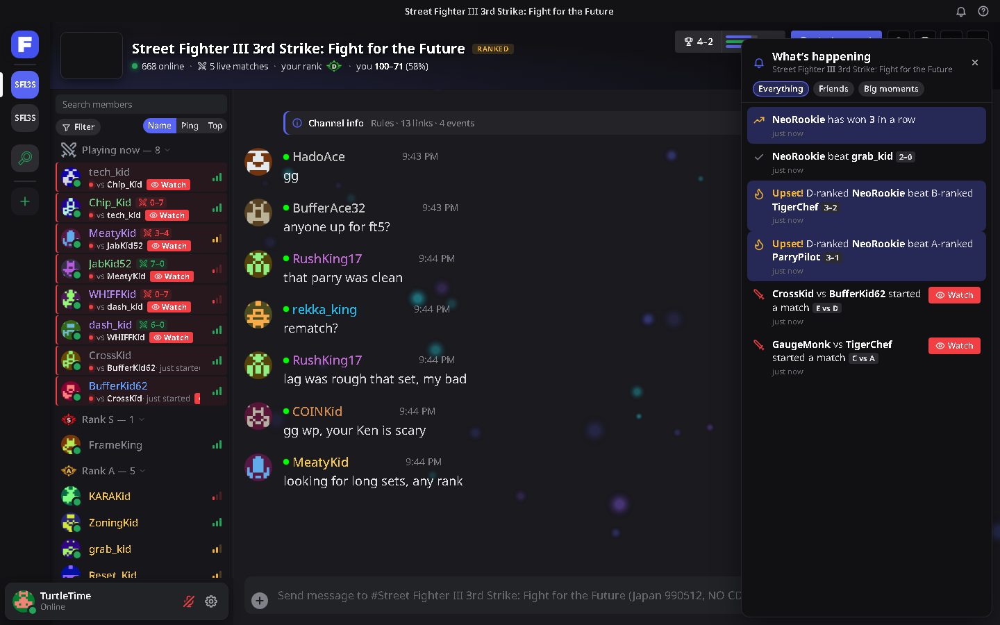

As capturas usam jogadores e conversas inventados (e mostram a versão em inglês).

O Fightcord (e o instalador) fala **inglês, português do Brasil e espanhol**. Ele segue o idioma do
Windows, ou escolha um em Configurações → Meu Fightcord → Idioma.

Tudo pode ser ligado ou desligado: **Ctrl+,** abre as configurações (ou digite `/fightcord`, e
`/help` lista todos os comandos do chat). Os perfis **Leve / Completo / Competitivo** trocam grupos
inteiros de uma vez.

## Privacidade

O Fightcord não tem servidor nem coleta de dados. Ele só conversa com:

| O quê | Onde | Quando |
|---|---|---|
| Dados de jogadores, resultados, rankings | A própria API do Fightcade (`web.fightcade.com`) | fichas, estatísticas, o feed, histórico de rank; os mesmos pedidos que o Fightcade faz |
| Tradução do chat | Google Tradutor (`translate.googleapis.com`) | mensagens recebidas que não estão no seu idioma, enquanto o tradutor está ligado (Configurações → Chat) |
| Prévias de links | YouTube / X / Streamable / Twitch | quando um link deles aparece no chat |
| Avatares, uma fonte | Gravatar, Google Fonts | como o Fightcade faz |
| Atualizações | este repositório no GitHub | uma vez por dia |
| Status no Discord | o app do Discord no seu PC | enquanto o status no Discord está ligado |
| Overlay do OBS | uma página em `127.0.0.1` que só este PC abre | enquanto o overlay está ligado (Configurações → Modo streamer) |
| "Quem tem o Fightcord" | relays Nostr públicos e gratuitos (`relay.damus.io`, `nos.lol`, `relay.primal.net`) | enquanto o Fightcade está aberto, a menos que você desligue "Mostrar que eu uso o Fightcord": seu nome no Fightcade, com hash, e se o chat de voz está ligado, a cada poucos minutos; os relays repassam ao vivo e não guardam |
| Chat de voz | os mesmos relays para o aperto de mão criptografado, depois direto o PC do seu oponente (STUN: Google / Cloudflare para achar o caminho) | só durante um set, só quando os dois entraram |
| Lobbies privados | relays Nostr públicos e gratuitos (`nos.lol`, `relay.primal.net`, `nostr.mom`, `offchain.pub`, `relay.damus.io`) | para os lobbies em que você está, enquanto o Fightcade está aberto: mensagens, entradas e sinais de "online", criptografados com uma chave que só existe no código de convite. Os relays guardam as mensagens criptografadas para você ver o que perdeu, mas não conseguem lê-las. A sala de voz vai direto entre os PCs dos jogadores, como o chat de voz |
| Imagens no chat | envio: `catbox.moe`; exibição: catbox, imgur, KLIPY, Tenor, Giphy, Discord; busca de GIFs: `api.klipy.com` (`tenor.com` se o KLIPY não responder) | o que você digita na busca do botão GIF vai para o KLIPY (ou o Tenor) quando você para de digitar, com um id aleatório desta instalação que o KLIPY pede; uma imagem só é enviada quando você clica em Enviar (pública para quem tiver o link); imagens desses sites carregam quando aparecem no chat (ou quando você clica nelas, com "Desfocar até clicar") |

Configurações, notas, amigos e histórico de partidas ficam na pasta do Fightcord no seu PC
(`<Fightcade>\fc2-electron\resources\app\inject\fightcord\`). Configurações → Backup e restauração
salva tudo num arquivo.

## Jogo limpo

O Fightcord só muda o que você vê e clica no app do Fightcade. Ele nunca mexe no emulador, na
memória do jogo, nos comandos ou no netcode, e nunca joga partidas nem envia, aceita ou recusa
desafios sozinho: os filtros de desafio só recusam os desafios que você mandou recusar.

## Perguntas frequentes

**Algo quebrou depois de uma atualização do Fightcade.** Segure **Shift** enquanto o Fightcade abre
para iniciá-lo sem o Fightcord (modo seguro), depois veja Configurações → Diagnóstico, ou abra uma
issue com o texto de "Copiar informações de depuração".

**Posso usar só uma parte?** Sim: Configurações → Meu Fightcord liga e desliga módulos individuais,
ou escolha o perfil Leve.

**Achei um erro de tradução.** As traduções são novas — abra uma issue ou um pull request em
`src/i18n-pt.js` (o app) ou `installer/i18n.json` (o instalador).

## Compilar você mesmo

Veja a seção [Building it yourself](README.md#building-it-yourself) no README em inglês: Windows,
Node.js 18+ e PowerShell, depois `powershell -ExecutionPolicy Bypass -File build.ps1`.

## Licença

[MIT](LICENSE). Fightcade, Discord e os jogos mostrados no Fightcade pertencem aos seus donos.
